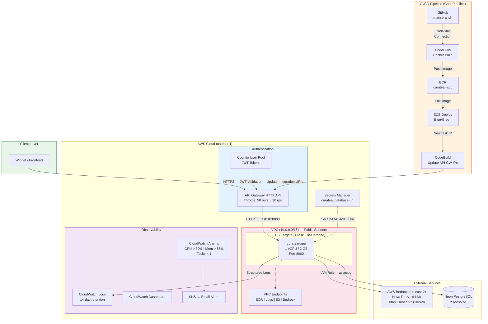
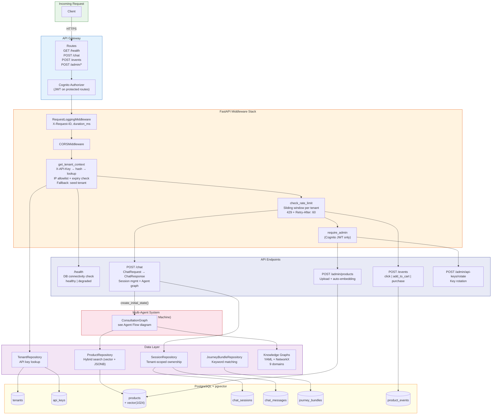
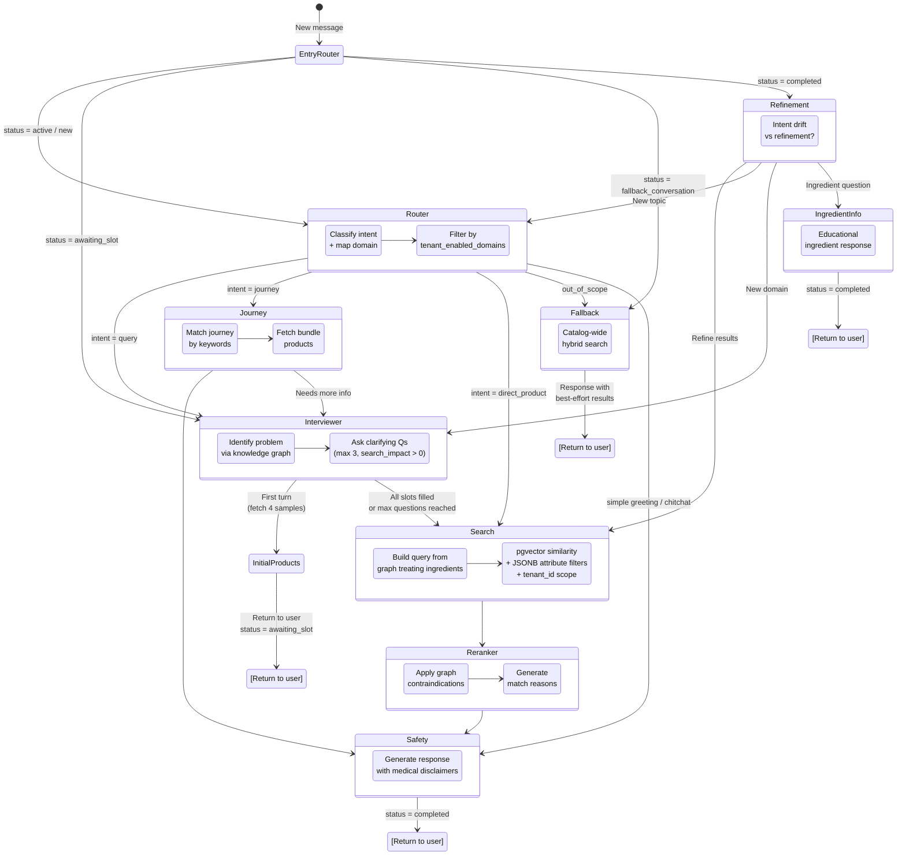
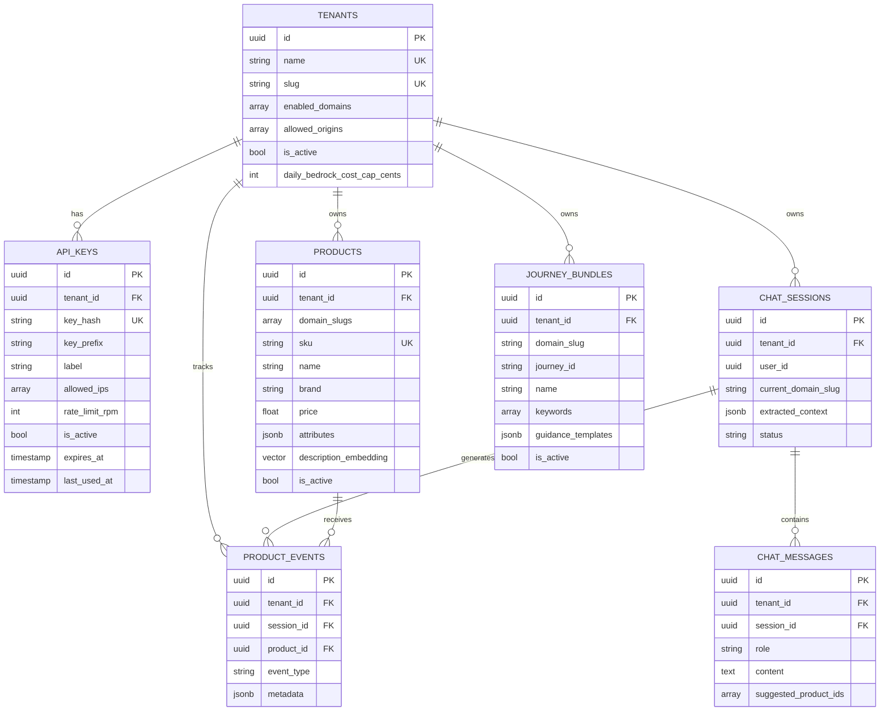
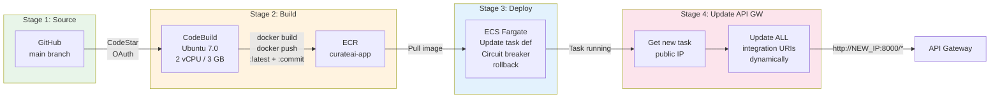
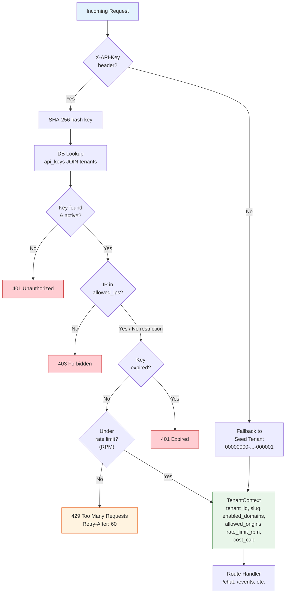

# CurateAI — End-to-End Architecture

## 1. Deployment & Infrastructure

## 2. Application Architecture (Request Flow)

## 3. Multi-Agent System (LangGraph State Machine)

## 4. Data Model (Entity Relationships)

## 5. CI/CD Pipeline (Detailed)

## 6. Authentication & Tenant Resolution

